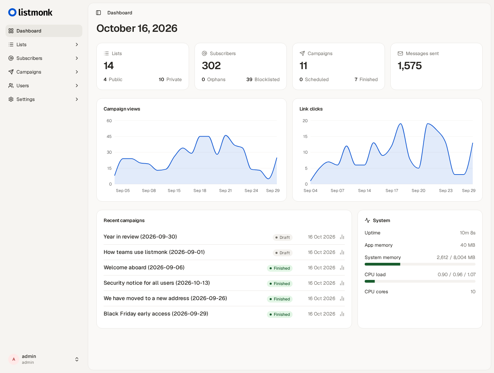

<a href="https://zerodha.tech"></a>

[](https://listmonk.app)

listmonk is a standalone, self-hosted, newsletter and mailing list manager. It is fast, feature-rich, and packed into a single binary. It uses a PostgreSQL database as its data store.



Visit [listmonk.app](https://listmonk.app) for more info. Check out the [**live demo**](https://demo.listmonk.app).

## About this fork

This fork replaces listmonk's server-rendered admin (Go templates and Alpine) with a React single-page app in [`frontend/`](frontend): TanStack Start (SPA mode), shadcn/ui and Tailwind CSS v4. It is linted and formatted with oxlint and oxfmt and built with [bun](https://bun.sh). The backend, API and database schema are unchanged, and the app is still one binary.

- Every page under `/admin` is a route of the SPA. Go embeds the build and serves it after the usual permission check.
- The public pages (subscription form, preferences, opt-in, archive) and the admin login pages are still Go templates in `static/public/`. Subscribers reach them from the links in emails. There is no public home page: `/` redirects to `/admin`.
- The upstream release binaries and the `listmonk/listmonk` Docker image contain the old admin, so build this fork from source.

## Build and run

Requirements: Go, bun and PostgreSQL.

```shell
cp config.toml.sample config.toml   # edit the database settings
make dist                           # builds the frontend and the Go binary into ./listmonk
./listmonk --install                # first run only: creates the DB schema (--upgrade for an existing DB)
./listmonk                          # http://localhost:9000/admin
```

### Docker

Coming from an existing upstream install? Follow [MIGRATING.md](MIGRATING.md).

A prebuilt image of this fork is on Docker Hub: [`mohamad416/listmonk-shadcn`](https://hub.docker.com/r/mohamad416/listmonk-shadcn), for `linux/amd64` and `linux/arm64`. The upstream `listmonk/listmonk` image has the old admin.

| Tag | Use |
| --- | --- |
| `v7.0.2-shadcn` | A pinned release. Use this in production. |
| `latest` | The newest build. |

It is the same single binary as upstream, configured with `LISTMONK_*` environment variables, so the upstream [configuration docs](https://listmonk.app/docs/configuration/) apply. The default command runs `--install --idempotent`, then `--upgrade`, then starts the server.

**Back up the database before changing tags.** `--upgrade` migrates the schema on start, and a migration cannot be undone: going from upstream v5.0.0 to this fork's `v7.0.x` applies the v5.1, v6.x and v7.0 migrations.

#### Quick start

`docker-compose.yml` in this repo uses the image. Set the admin account for the first start, then run it:

```shell
LISTMONK_ADMIN_USER=admin LISTMONK_ADMIN_PASSWORD='choose-a-password' docker compose up -d
```

Open <http://localhost:9000/admin>. If you skip the two variables, the first visit asks you to create the Super Admin.

The compose files below keep the database credentials in variables. Change `POSTGRES_PASSWORD` before you expose anything.

#### Deploy on Dokploy

Tested on a live Dokploy instance.

1. **Create the service.** In a project, add a service of type **Compose**, with the compose type `docker-compose` and the source **Raw**.
2. **Paste this compose file.** It publishes no host ports, because Dokploy's Traefik routes to the container:

   ```yaml
   services:
     db:
       image: postgres:17-alpine
       restart: unless-stopped
       environment:
         - POSTGRES_USER=listmonk
         - POSTGRES_PASSWORD=${POSTGRES_PASSWORD}
         - POSTGRES_DB=listmonk
       healthcheck:
         test: ["CMD-SHELL", "pg_isready -U listmonk"]
         interval: 10s
         timeout: 5s
         retries: 6
       volumes:
         - listmonk-data:/var/lib/postgresql/data

     app:
       image: mohamad416/listmonk-shadcn:v7.0.2-shadcn
       restart: unless-stopped
       depends_on:
         db:
           condition: service_healthy
       environment:
         - LISTMONK_app__address=0.0.0.0:9000
         - LISTMONK_db__user=listmonk
         - LISTMONK_db__password=${POSTGRES_PASSWORD}
         - LISTMONK_db__database=listmonk
         - LISTMONK_db__host=db
         - LISTMONK_db__port=5432
         - LISTMONK_db__ssl_mode=disable
         - LISTMONK_ADMIN_USER=${LISTMONK_ADMIN_USER}
         - LISTMONK_ADMIN_PASSWORD=${LISTMONK_ADMIN_PASSWORD}
         - TZ=Etc/UTC
       command: [sh, -c, "./listmonk --install --idempotent --yes --config '' && ./listmonk --upgrade --yes --config '' && ./listmonk --config ''"]
       volumes:
         - listmonk-uploads:/listmonk/uploads

   volumes:
     listmonk-data:
     listmonk-uploads:
   ```

3. **Set the environment.** In the **Environment** tab add `POSTGRES_PASSWORD`, `LISTMONK_ADMIN_USER` and `LISTMONK_ADMIN_PASSWORD`.
4. **Add the domain.** Point a DNS A record at the server, then in the **Domains** tab add the host with service name `app`, port `9000`, HTTPS on and the Let's Encrypt certificate.
5. **Deploy** and open `https://<your-domain>/admin`.
6. **Set the Root URL.** In **Settings → General**, set it to the public URL. Links in emails and on the public pages are built from it.

To update, change the tag in the compose file and click **Deploy**. Take a `pg_dump` first (for example from a one-off service that mounts the same volume).

#### Deploy on Coolify

These steps follow Coolify's documented compose variables (`SERVICE_FQDN_*` and `SERVICE_PASSWORD_*`). They have not been run against a Coolify instance, so check them on a test resource first.

1. **Create the resource.** In a project and environment choose **New → Docker Compose Empty** and paste:

   ```yaml
   services:
     app:
       image: mohamad416/listmonk-shadcn:v7.0.2-shadcn
       restart: unless-stopped
       depends_on:
         db:
           condition: service_healthy
       environment:
         - SERVICE_FQDN_APP_9000
         - LISTMONK_app__address=0.0.0.0:9000
         - LISTMONK_db__user=$SERVICE_USER_POSTGRES
         - LISTMONK_db__password=$SERVICE_PASSWORD_POSTGRES
         - LISTMONK_db__database=listmonk
         - LISTMONK_db__host=db
         - LISTMONK_db__port=5432
         - LISTMONK_db__ssl_mode=disable
         - LISTMONK_ADMIN_USER=${LISTMONK_ADMIN_USER:?}
         - LISTMONK_ADMIN_PASSWORD=${LISTMONK_ADMIN_PASSWORD:?}
         - TZ=Etc/UTC
       command: [sh, -c, "./listmonk --install --idempotent --yes --config '' && ./listmonk --upgrade --yes --config '' && ./listmonk --config ''"]
       volumes:
         - listmonk-uploads:/listmonk/uploads

     db:
       image: postgres:17-alpine
       restart: unless-stopped
       environment:
         - POSTGRES_USER=$SERVICE_USER_POSTGRES
         - POSTGRES_PASSWORD=$SERVICE_PASSWORD_POSTGRES
         - POSTGRES_DB=listmonk
       healthcheck:
         test: ["CMD-SHELL", "pg_isready -U $${POSTGRES_USER}"]
         interval: 10s
         timeout: 5s
         retries: 6
       volumes:
         - listmonk-data:/var/lib/postgresql/data

   volumes:
     listmonk-data:
     listmonk-uploads:
   ```

2. **Set the variables.** Coolify generates the Postgres user and password from the `SERVICE_*` names. Fill in `LISTMONK_ADMIN_USER` and `LISTMONK_ADMIN_PASSWORD` on the **Environment Variables** page.
3. **Set the domain.** `SERVICE_FQDN_APP_9000` makes Coolify proxy the `app` service on port 9000. Edit its domain on the configuration page, for example `https://list.example.com`, and point the DNS A record at the server.
4. **Deploy**, then open `https://list.example.com/admin` and set **Settings → General → Root URL** to the same address.

Update by changing the tag and redeploying. Back up the database first.

#### Build your own image

`Dockerfile.build` builds the frontend, the Go binary and the runtime image in one step. Use it for another architecture, or to run your own changes:

```shell
docker buildx build --platform linux/amd64,linux/arm64 -f Dockerfile.build \
  --build-arg VERSION=v7.0.2-shadcn --build-arg COMMIT=$(git rev-parse --short HEAD) \
  -t <registry>/listmonk-shadcn:<tag> --push .
```

The root `Dockerfile` only packages a prebuilt `./listmonk` binary (`make dist`, goreleaser).

### Local network

Set `address = "0.0.0.0:9000"` in `config.toml` so other devices can connect, then set **Settings → General → Root URL** to the address they use, for example `http://192.168.1.28:9000`. Links on the public pages and in emails are built from that URL.

## Developers

The Docker dev environment bundles Go, Postgres, bun and Playwright:

```shell
make build-dev-docker   # once
make run-dev-docker     # starts the services and opens a shell
make run                # inside the shell: builds the assets, installs a fresh DB, serves :9000
```

Frontend commands, run in `frontend/` (the same checks run in CI):

```shell
bun install
bun run dev          # Vite dev server, proxies /api to :9000
bun run lint         # oxlint
bun run fmt          # oxfmt
bun run typecheck
bun test
bun run build
```

`dev/seed/` fills a dev instance with fake data (`cd dev/seed && bun install && bun seed.ts`), and `tests/` holds the Playwright suite (it wipes the dev database). See the [developer setup](docs/docs/content/developer-setup.md) for the full workflow, including how to add a page.

The upstream [installation docs](https://listmonk.app/docs/installation) and [developer docs](https://listmonk.app/docs/developer-setup) describe the original project and may not match this fork.

## License
listmonk is licensed under the AGPL v3 license.
